<!-- Images in assets/ are generated by scripts/build.mjs; .github/workflows/profile.yml refreshes the stats daily. -->

<a href="https://www.aswirc.nl">
  <picture>
    <source media="(prefers-color-scheme: dark)" srcset="assets/banner-dark.svg">
    
  </picture>
</a>

<p align="center">
  <a href="https://www.aswirc.nl"><picture><source media="(prefers-color-scheme: dark)" srcset="assets/btn-site-dark.svg"></picture></a>&nbsp;
  <a href="https://www.linkedin.com/in/armand-swirc-711282347"><picture><source media="(prefers-color-scheme: dark)" srcset="assets/btn-linkedin-dark.svg"></picture></a>&nbsp;
  <a href="https://github.com/HR-Business-Datalab"><picture><source media="(prefers-color-scheme: dark)" srcset="assets/btn-datalab-dark.svg"></picture></a>
</p>

<br>

<picture>
  <source media="(prefers-color-scheme: dark)" srcset="assets/title-about-dark.svg">
  
</picture>

I study marketing by day and build AI products by night. I don't make mockups: everything I build runs for real, from AI platforms and brand sites to internal tools and the occasional simulation of the entire planet.

```ts
const armand = {
  base:     "Rotterdam, NL",
  day:      "Marketing student",
  night:    "AI developer",
  building: [
    "AI platforms for research & education @ HR Business Datalab",
    "local-first LLM tooling and MCP servers",
    "games & simulations in Godot, C# and TypeScript",
    "iOS apps in Swift",
  ],
  motto:    "Real products, live on the internet. No mockups.",
};
```

<br>

<picture>
  <source media="(prefers-color-scheme: dark)" srcset="assets/title-datalab-dark.svg">
  
</picture>

Most of my code goes into the [**HR Business Datalab**](https://github.com/HR-Business-Datalab) at Hogeschool Rotterdam. We build AI apps that students, researchers and teachers use for real coursework and research. I'm the main developer behind the apps below and the platform they share: one portal and one login, with every model call going through a shared AI gateway.

<picture>
  <source media="(prefers-color-scheme: dark)" srcset="assets/datalab-dark.svg">
  
</picture>

<details>
<summary><b>What each app does</b></summary>
<br>

| App | For | What it does |
|---|---|---|
| **STRICT** | researchers & students | Upload interview audio and get a transcript with speakers. Code it with codebooks, run interview and cross-case analyses, chat with the material and export reports. |
| **FORM** | teachers & students | AI-assisted review of student work against rubrics, transcription with speaker roles, and formative feedback. |
| **ATHENA** | everyone at the university | A streaming AI chat with a quick and a thorough mode, web search and file reading. Its mascot is a pixel owl. |
| **SOS** | teachers | Pick a course, week and lesson, chat with the studio and watch the slides appear live in the house template. Export to PPTX. |
| **AGENDATA** | teachers | Request a synthetic dataset for a course. The Datalab generates it, checks it with an AI review and releases it for class. |
| **Platform** | every app | Central login and portal, roles, shared AI gateways and the deploy setup every app runs on. |

</details>

<br>

<picture>
  <source media="(prefers-color-scheme: dark)" srcset="assets/title-builds-dark.svg">
  
</picture>

<p align="center">
  <a href="https://github.com/ArmandSwirc/Terraweb"><picture><source media="(prefers-color-scheme: dark)" srcset="assets/card-terraweb-dark.svg"></picture></a>
  <a href="https://github.com/ArmandSwirc/battleshipbench"><picture><source media="(prefers-color-scheme: dark)" srcset="assets/card-battleshipbench-dark.svg"></picture></a>
  <a href="https://github.com/ArmandSwirc/TimeChimpMCP"><picture><source media="(prefers-color-scheme: dark)" srcset="assets/card-timechimpmcp-dark.svg"></picture></a>
  <a href="https://github.com/ArmandSwirc/Markt-analyse-tool"><picture><source media="(prefers-color-scheme: dark)" srcset="assets/card-markt-analyse-tool-dark.svg"></picture></a>
</p>

<br>

<picture>
  <source media="(prefers-color-scheme: dark)" srcset="assets/title-toolbox-dark.svg">
  
</picture>

<p align="center">
  <picture>
    <source media="(prefers-color-scheme: dark)" srcset="https://skillicons.dev/icons?i=ts%2Cjs%2Cpy%2Ccs%2Cswift%2Cgodot%2Cunity%2Crust%2Chtml%2Ccss%2Creact%2Cnextjs%2Ctailwind%2Cnodejs%2Cdocker%2Cpostgres%2Cprisma%2Credis%2Cgit&perline=10&theme=dark">
    
  </picture>
</p>

<p align="center">
  
  
  
</p>

<br>

<picture>
  <source media="(prefers-color-scheme: dark)" srcset="assets/title-numbers-dark.svg">
  
</picture>

<p align="center">
  <picture><source media="(prefers-color-scheme: dark)" srcset="assets/stats-dark.svg"></picture>
  <picture><source media="(prefers-color-scheme: dark)" srcset="assets/languages-dark.svg"></picture>
</p>

<picture>
  <source media="(prefers-color-scheme: dark)" srcset="https://raw.githubusercontent.com/ArmandSwirc/ArmandSwirc/output/snake-dark.svg">
  
</picture>

<p align="center"><sub>Built in Rotterdam · stats refresh daily via GitHub Actions</sub></p>
